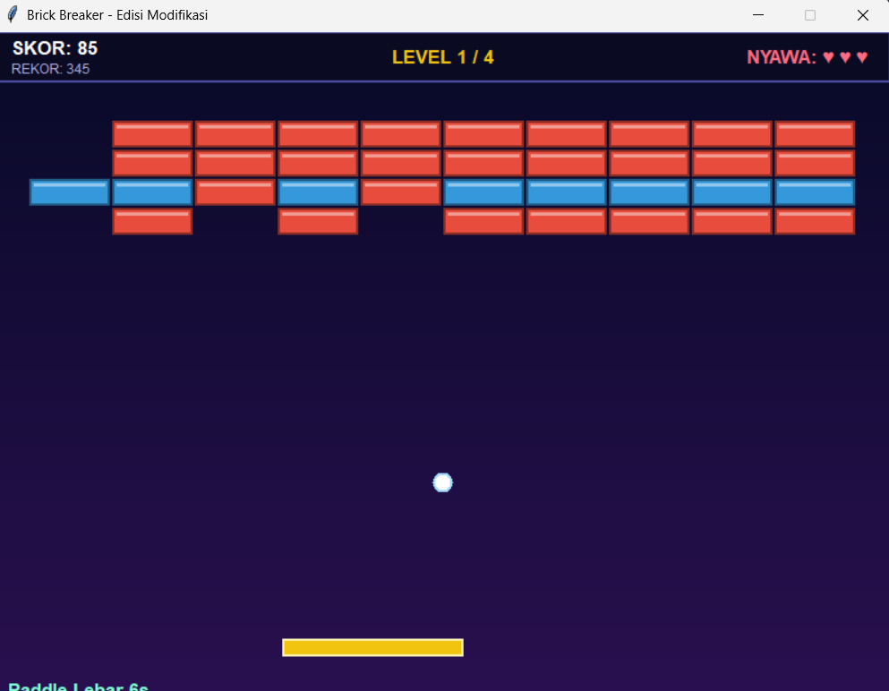

# 🧱 Brick Breaker — Edisi Modifikasi

|                 |                           |
| --------------- | ------------------------- |
| **Nama**        | Mahardika Putra Qohar     |
| **NIM**         | 20250140096               |
| **Mata kuliah** | Pemrograman Multiplatform |

Modifikasi game Brick Breaker (Python + Tkinter). Karena hanya memakai Python dan Tkinter, game berjalan di **Windows, macOS, dan Linux** tanpa library tambahan.

```bash
python brick_breaker.py        # Linux: sudo apt install python3-tk
```

**Kontrol:** `←` `→` / `A` `D` / mouse = gerak paddle · `SPASI` / klik = mulai & luncurkan bola · `P` = pause · `R` = restart

---

## 🔄 Perubahan dari Kode Awal

### Perbaikan error

- Tanda kutip ganda dua kali (`''white''`) diperbaiki → kode awal sebenarnya tidak bisa dijalankan.
- Nyawa: kode awal game over saat `lives < 0` (jadi 4 nyawa). Sekarang tepat 3 nyawa.
- Game tidak bisa diulang setelah menang/kalah. Sekarang tekan `SPASI` atau `R`.

### Per kelas

| Kelas        | Dipertahankan                                | Diubah / dihapus                                                                                                                                                         | Ditambahkan                                                                |
| ------------ | -------------------------------------------- | ------------------------------------------------------------------------------------------------------------------------------------------------------------------------ | -------------------------------------------------------------------------- |
| `GameObject` | `move()`, `delete()`                         | `get_position()` dihapus (posisi disimpan di atribut)                                                                                                                    | –                                                                          |
| `Ball`       | Konsep bola + `Ball(canvas, x, y)`           | Arah dari `[1, -1]` (hanya 45°) jadi vektor `dx, dy` bebas; posisi float; kecepatan naik per level; `update()` dan `collide()` dihapus, diganti `Game.update_ball()`     | `set_angle()`, `render()`, `stuck` (menempel di paddle), `fire` (Fireball) |
| `Paddle`     | Bentuk persegi panjang                       | Lebar 80 → 100; `move(offset)` dan `set_ball()` diganti `move_to()` yang dibatasi layar                                                                                  | `rect`, lebar dinamis (power-up)                                           |
| `Brick`      | `hit()`, warna sesuai sisa pukulan           | Tipe jadi `1 2 3 # E`; `hit()` hanya mengembalikan `True/False`, penghapusan diurus `Game.destroy()`                                                                     | Brick baja (kebal), brick peledak, kilap 3D, `delete()` di-override        |
| `Game`       | `tk.Frame`, nyawa, HUD, brick di bagian atas | Layar 610×400 → 800×600; loop 20 FPS → 60 FPS (delta-time); brick dari pola `LEVELS`; kontrol berbasis status tombol; tabrakan `find_overlapping` → lingkaran-vs-persegi | Lihat daftar di bawah                                                      |
| `main`       | `tk.Tk()`, `Game(root).mainloop()`           | Judul jendela diganti, ukuran jendela dikunci                                                                                                                            | –                                                                          |

### Kelas & fungsi baru

`PowerUp`, `Particle`, `mix()`, `clamp()`, `LEVELS`, `Game.update()`, `update_ball()`, `update_powers()`, `destroy()`, `apply()`, `level_clear()`, `finish()`, `pause()`, `new_game()`, `load_high()`, `close()`, `overlay()`.

---

## ✨ Fitur Baru

Setiap fitur ditandai `[FITUR n]` di komentar kode.

| #   | Fitur                                  | Penjelasan singkat                                                          |
| --- | -------------------------------------- | --------------------------------------------------------------------------- |
| 1   | Game loop 60 FPS + kesulitan progresif | Gerakan dikali `dt`; bola makin cepat tiap level                            |
| 2   | Fisika bola                            | Sudut pantul bergantung bagian paddle yang kena (maks 65°)                  |
| 3   | 4 level                                | Pola brick berupa teks di `LEVELS`                                          |
| 4   | 5 tipe brick                           | 1x, 2x, 3x pukul (warna berubah), baja kebal, peledak                       |
| 5   | Power-up                               | **W** paddle lebar · **M** multi-ball · **F** fireball · **L** nyawa +1     |
| 6   | Fireball & Multi-Ball                  | Fireball menembus brick; Multi-Ball memecah tiap bola jadi 3                |
| 7   | Combo                                  | Hancurkan brick beruntun tanpa kena paddle → skor ×2 tiap 5 combo (maks ×5) |
| 8   | Latar gradasi                          | Biru tua → ungu                                                             |
| 9   | Partikel                               | Serpihan saat brick hancur                                                  |
| 10  | HUD                                    | Skor, rekor, level, nyawa, combo, sisa waktu efek                           |
| 11  | Kontrol mulus                          | Keyboard + mouse                                                            |
| 12  | Menu, pause, state machine             | `menu → ready → playing → levelclear → gameover/win`                        |
| 13  | Rekor tersimpan                        | Disimpan di `highscore.json`                                                |
| 14  | Brick peledak berantai                 | Brick `E` menghancurkan brick radius 100 px, brick `E` lain ikut meledak    |

## 🛠️ Menambah Level

Tambahkan pola ke `LEVELS` (tiap baris 10 karakter): `1 2 3` brick, `#` baja, `E` peledak, `.` kosong.

TAMPILAN GAME



