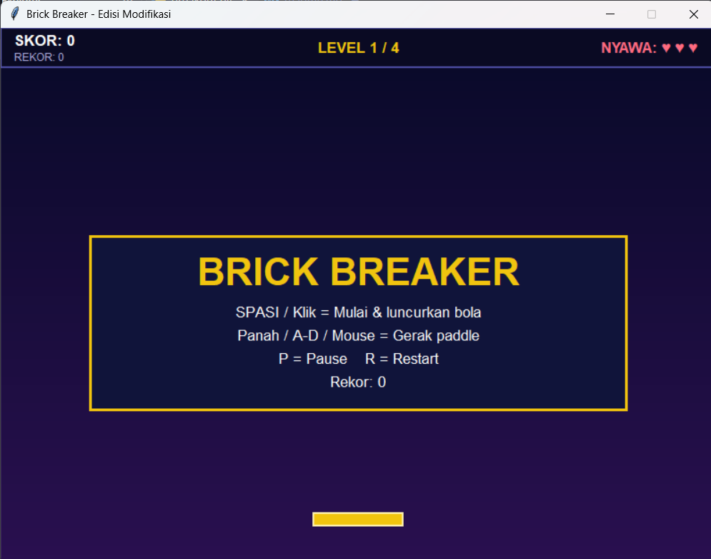
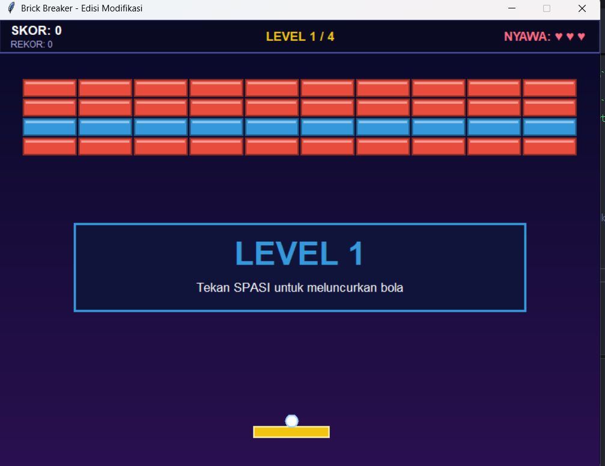

# 🧱 Brick Breaker — Edisi Modifikasi

Modifikasi game **Brick Breaker** bawaan (Python + Tkinter) dengan prinsip **PBO** dan 14 fitur baru.

> **Nama / NIM:** `[isi di sini]`

## ▶️ Cara Menjalankan

```bash
python brick_breaker.py
```

Butuh Python 3.6+ dengan Tkinter (Linux: `sudo apt install python3-tk`). Tidak perlu library tambahan.

## 🎮 Kontrol

| Tombol                    | Fungsi                              |
| ------------------------- | ----------------------------------- |
| `←` `→` / `A` `D` / Mouse | Gerakkan paddle                     |
| `SPASI` / Klik kiri       | Mulai, luncurkan bola, lanjut level |
| `P`                       | Pause / lanjut                      |
| `R`                       | Restart                             |

## 🔍 Perbandingan dengan Versi Bawaan

| Aspek                                      | Bawaan               | Modifikasi                          |
| ------------------------------------------ | -------------------- | ----------------------------------- |
| Layar                                      | 610 × 400            | 800 × 600                           |
| Frame                                      | 20 FPS               | ~60 FPS (delta-time)                |
| Level                                      | 1                    | 4 level, kecepatan naik tiap level  |
| Tipe brick                                 | 2                    | 5 (1x, 2x, 3x, baja kebal, peledak) |
| Pantulan paddle                            | Sama di semua bagian | Bergantung bagian paddle yang kena  |
| Power-up, combo, rekor, pause, efek visual | Tidak ada            | Ada                                 |

## ✨ Daftar Fitur

Setiap fitur ditandai `[FITUR n]` di komentar `brick_breaker.py`.

| #   | Fitur                                  | Penjelasan                                                                                                                                            |
| --- | -------------------------------------- | ----------------------------------------------------------------------------------------------------------------------------------------------------- |
| 1   | Game loop 60 FPS + kesulitan progresif | Gerakan dikali `dt` agar kecepatan konsisten di PC lambat/cepat. Kecepatan bola naik tiap level dan tiap kena paddle.                                 |
| 2   | Fisika bola                            | Posisi float + vektor arah. Tabrakan lingkaran-vs-persegi. Sudut pantul paddle bergantung titik tumbukan (tengah = lurus, pinggir = miring maks 65°). |
| 3   | 4 level                                | Pola brick berupa teks di `LEVELS`, mudah menambah level. Bonus skor sisa nyawa tiap level selesai.                                                   |
| 4   | 5 tipe brick                           | `1` `2` `3` = jumlah pukulan (warna berubah tiap kena), `#` baja kebal, `E` peledak.                                                                  |
| 5   | Power-up                               | Peluang drop 18%, ditangkap dengan paddle (tabel di bawah).                                                                                           |
| 6   | Fireball & Multi-Ball                  | Fireball menembus brick tanpa memantul (kecuali baja). Multi-Ball memecah tiap bola jadi 3.                                                           |
| 7   | Combo                                  | Hancurkan brick beruntun tanpa kena paddle → pengali skor ×2 tiap 5 combo (maks ×5).                                                                  |
| 8   | Latar gradasi                          | Gradasi biru tua → ungu dari 60 strip.                                                                                                                |
| 9   | Partikel                               | Serpihan berwarna saat brick hancur, kena gravitasi lalu hilang.                                                                                      |
| 10  | HUD                                    | Skor, rekor, level, nyawa, combo, dan efek aktif beserta sisa waktu.                                                                                  |
| 11  | Kontrol mulus                          | Keyboard (berbasis status tombol, bukan key-repeat) + mouse.                                                                                          |
| 12  | State machine + menu + pause           | `menu → ready → playing → levelclear → gameover/win`, plus `paused`.                                                                                  |
| 13  | Rekor tersimpan                        | High score disimpan di `highscore.json`.                                                                                                              |
| 14  | Brick peledak berantai                 | Brick `E` menghancurkan brick radius 100 px; brick `E` lain ikut meledak.                                                                             |

### Power-up

| Kapsul   | Efek                          |
| -------- | ----------------------------- |
| 🟩 **W** | Paddle lebar 1.6× (~10 detik) |
| 🟨 **M** | Multi-Ball                    |
| 🟧 **F** | Fireball (~10 detik)          |
| 🟥 **L** | Nyawa +1 (maks 5)             |

## 🧬 Struktur Kelas (Konsep PBO)

```
GameObject            (induk: canvas, item, move, delete)
 ├── Ball             (bola: arah, kecepatan, mode api)
 ├── Paddle           (lebar dinamis)
 ├── Brick            (tipe, sisa pukulan, warna)
 ├── PowerUp          (kapsul jatuh)
 └── Particle         (serpihan)
Game(tk.Frame)        (input, loop, tabrakan, skor, level)
```

- **Inheritance** — semua objek game mewarisi `GameObject`.
- **Polymorphism** — `delete()` di-override (`Brick` hapus kilap, `PowerUp` hapus huruf); `move()` di `PowerUp` menggerakkan kapsul + huruf.
- **Encapsulation** — tiap kelas mengurus datanya sendiri (`Brick.hit()`, `Ball.set_angle()`).
- **Composition** — `Game` memiliki list `bricks`, `balls`, `powers`, `parts`.

## 🛠️ Menambah Level

Tambahkan pola ke `LEVELS` (tiap baris tepat 10 karakter):

```python
['1111111111', '#.E.22.E.#', '3333333333']   # # = baja, E = peledak, . = kosong
```

TAMPILAN GAME


